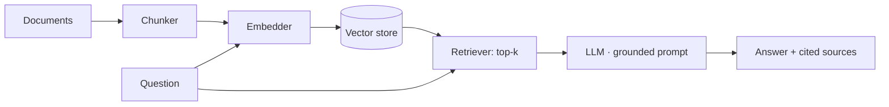

# rag-service — retrieval-augmented generation with evals

> RAG over a document corpus: **chunk → embed → index**, then for each question
> **retrieve the most similar chunks and answer grounded in them**, with
> citations. The embedder and the LLM are **ports**, so the pipeline runs
> deterministically offline in tests (hashing embedder + extractive answerer)
> and swaps in Claude for production. Ships with an **automated evals** harness.


> ℹ️ An **original reference implementation** of a RAG system. No proprietary
> code or data.

---

## Pipeline



- **Chunking** — overlapping word windows so facts that straddle a boundary stay
  retrievable.
- **Embeddings** — an `Embedder` port. The bundled `HashingEmbedder` is
  deterministic and dependency-free (token hashing + L2 norm), so retrieval has
  real cosine behavior in tests; a transformer embedder drops in for production.
- **Vector store** — in-memory cosine top-k (FAISS / pgvector in production,
  same `add` / `search` interface).
- **Generation** — an `LLMClient` port. `ExtractiveLLM` answers *verbatim from
  the retrieved context* (never hallucinates) for offline/test use; `AnthropicLLM`
  builds a grounded prompt and calls Claude when `ANTHROPIC_API_KEY` is set.
- **Answers cite their sources** — the documents the retrieved chunks came from.

## Evals

A RAG system is only as good as it is measurable. [`evals.py`](src/rag/evals.py)
scores answers on three axes:

- **Relevance** — does the answer contain the expected facts?
- **Groundedness** — are the answer's tokens actually supported by the retrieved
  context (not invented)?
- **Source attribution** — did it cite the right document?

```bash
python -m rag eval      # runs the bundled dataset; non-zero exit if any case fails
```

---

## Run it

```bash
pip install -e ".[dev]"

# ask over the bundled sample docs (offline, deterministic)
python -m rag ask "Where are production secrets stored?"

# run the HTTP API
python -m rag serve      # POST /api/ingest, POST /api/ask

# with a real model:
export ANTHROPIC_API_KEY=sk-...   # pipeline switches to Claude automatically
```

## Tests

```bash
pytest -q
```
Covers chunking + overlap, embedder determinism and similarity ordering, vector
store top-k, the end-to-end pipeline (grounded answer + correct source +
declining the unknown), and the evals harness — all offline, no API key.

---

## Design decisions

- **Embedder and LLM as ports** — the retrieval and grounding logic is tested
  deterministically with no model downloads or API calls; production swaps in
  real implementations without touching the pipeline.
- **Extractive answerer for tests** — makes "is the answer grounded?" a true
  assertion, and keeps CI hermetic.
- **Evals in the repo + in CI** — groundedness/relevance/attribution are checked
  on every push, not just unit behavior.

---

*An original reference implementation. No proprietary code, data, or confidential information is included.*
